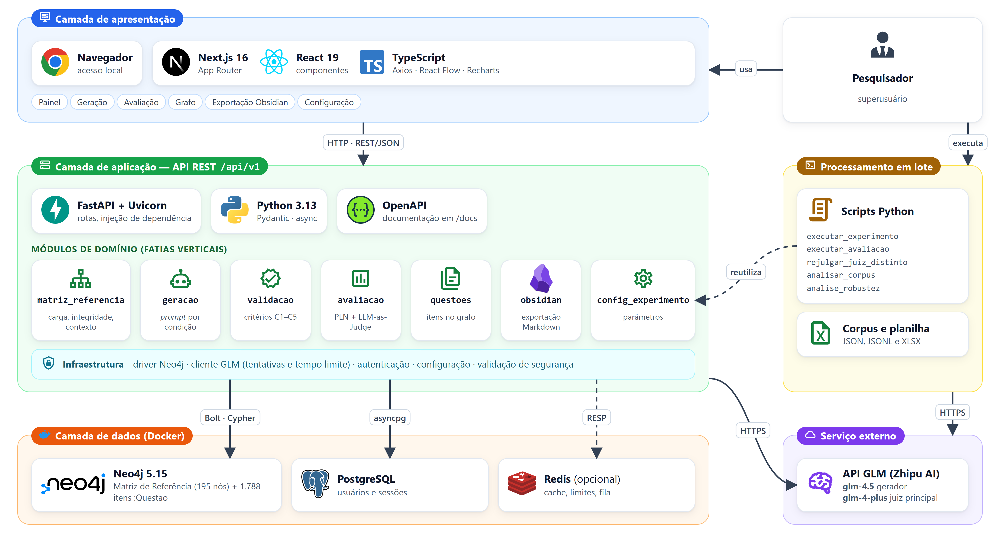

# Graph-Driven Exam Gen

Plataforma GraphRAG para geração de itens de múltipla escolha ancorados na Matriz de Referência do ENEM.

Este repositório acompanha o Trabalho de Conclusão de Curso *"Graph-Driven Exam Gen: Plataforma GraphRAG para geração de itens com ancoragem na Matriz de Referência do ENEM"*, de Jeová Bezerra Leite (Engenharia de Software, UPE Campus Garanhuns, 2026). O trabalho estende o artigo de Leite (2026), que reportou o protótipo em 10 habilidades e 150 itens.

A plataforma modela a Matriz de Referência do ENEM (4 áreas, 30 competências, 120 habilidades e 41 objetos de conhecimento) como grafo de propriedades no Neo4j. Ela injeta o contexto curricular de cada habilidade no *prompt* de um LLM (GLM, Zhipu AI) e liga cada item gerado à sua habilidade por uma aresta verificável. O experimento comparou três condições de geração (`com_grafo`, `com_fewshot_sem_grafo` e `sem_grafo`) nas 120 habilidades. Os 1.788 itens gerados foram avaliados por métricas de PLN e por LLM-as-Judge, com um juiz distinto do modelo gerador.



## Dados do experimento

| Arquivo | Conteúdo |
|---|---|
| [`backend/data/questoes_geradas.xlsx`](backend/data/questoes_geradas.xlsx) | **Planilha auditável do corpus** (9 abas, com *Leia-me* e dicionário de dados). Para cada um dos 1.788 itens: enunciado, alternativas, gabarito e justificativa; área, competência, habilidade e objetos de conhecimento; cada critério estrutural C1–C5; marcação de enunciado repetido e similaridade com os demais itens da célula; $C(i,h)$ e $E(i,h)$ gravados e recalculados; TTR e FKGL; o juiz principal (`glm-4-plus`: notas D1–D5, justificativa, resposta bruta, *tokens*, data/hora e parâmetros) e o secundário (`glm-4.5`: notas e justificativa); e os *prompts* integrais de geração e do juiz. Outras abas: resumo por condição, médias por habilidade, Matriz, objetos de conhecimento, todos os resultados estatísticos e os *templates* de *prompt* |
| [`backend/data/questoes_export.json`](backend/data/questoes_export.json) | Corpus completo em JSON, exportado do Neo4j |
| [`backend/data/julgamento_glm-4-plus.jsonl`](backend/data/julgamento_glm-4-plus.jsonl) | Julgamento do juiz principal: uma linha por item, com notas, justificativa, consumo de *tokens*, horário e resposta bruta |
| [`backend/data/matriz_referencia.json`](backend/data/matriz_referencia.json) | Matriz de Referência estruturada (fonte da carga do grafo) |
| [`backend/data/resultado_analise_estatistica.json`](backend/data/resultado_analise_estatistica.json), [`resultado_robustez.json`](backend/data/resultado_robustez.json), [`resultado_juiz_distinto_glm-4-plus.json`](backend/data/resultado_juiz_distinto_glm-4-plus.json), [`resultado_robustez_duplicatas.json`](backend/data/resultado_robustez_duplicatas.json), [`conferencia_extracao_matriz.json`](backend/data/conferencia_extracao_matriz.json) | Resultados da análise estatística, da robustez, da comparação entre juízes, do teste sem os 40 itens de enunciado repetido e da conferência da extração |

**O que não está disponível:** as respostas brutas, os *tokens* e os horários da etapa de geração e do juiz secundário não foram preservados; o bloco de exemplos *few-shot* foi enviado vazio; e a similaridade semântica não foi calculada. Os detalhes estão na aba *Leia-me* da planilha.

## Estrutura

```
backend/            API FastAPI (Python 3.13)
  src/modules/      módulos de domínio: matriz_referencia, geracao, validacao,
                    avaliacao, questoes, obsidian, config_experimento
  src/analysis/     análise estatística (Shapiro-Wilk, Kruskal-Wallis, Mann-Whitney)
  scripts/          experimento, julgamento, rejulgamento, análise e planilha
  tests/            testes de unidade e de integração
  data/             corpus, julgamentos, planilha e resultados
frontend/           interface Next.js 16 / React 19 (6 telas)
docs/diagramas/     diagramas de arquitetura e implantação (fonte HTML + PNG)
docker-compose.neo4j.yml
```

## Como executar

Pré-requisitos: Docker, [uv](https://docs.astral.sh/uv/) e Node.js. Copie `backend/.env.example` para `backend/.env` e preencha a chave da API GLM (`GLM_API_KEY`) e as senhas.

```bash
# dependências e banco de grafos (na raiz)
uv sync --all-packages --all-extras
docker compose -f docker-compose.neo4j.yml up -d

# carga da Matriz e superusuário inicial (em backend/)
uv run python -m scripts.load_matriz_referencia
uv run python -m scripts.setup_initial_data

# API em http://localhost:8000 (documentação em /docs)
uv run fastapi dev src/interfaces/main.py

# interface em http://localhost:3000 (em frontend/)
npm install && npm run dev

# experimento, julgamento, análise e planilha (em backend/)
uv run python -m scripts.executar_experimento --limite 2   # piloto com 2 habilidades
uv run python -m scripts.executar_avaliacao
uv run python -m scripts.rejulgar_juiz_distinto --modelo glm-4-plus
uv run python -m scripts.analisar_corpus
uv run python -m scripts.analise_robustez
uv run python -m scripts.analisar_juiz_distinto
uv run python -m scripts.analise_duplicatas
uv run --with openpyxl python -m scripts.build_xlsx

# testes (em backend/): 281 de unidade + 47 de integração
uv run pytest
```

Cada execução de `executar_experimento` acrescenta novos itens ao grafo; ela não sobrescreve os anteriores.

## Créditos e licença

O *backend* foi construído sobre o [FastAPI boilerplate da Benav Labs](https://github.com/benavlabs/FastAPI-boilerplate), sob licença MIT ([LICENSE.md](LICENSE.md)). O README original do boilerplate está em [`docs/README-boilerplate.md`](docs/README-boilerplate.md), e a documentação dele, em `docs/`. A Matriz de Referência do ENEM é um documento público do INEP. Os ícones dos diagramas vêm das coleções Iconify Logos e Material Design Icons.
